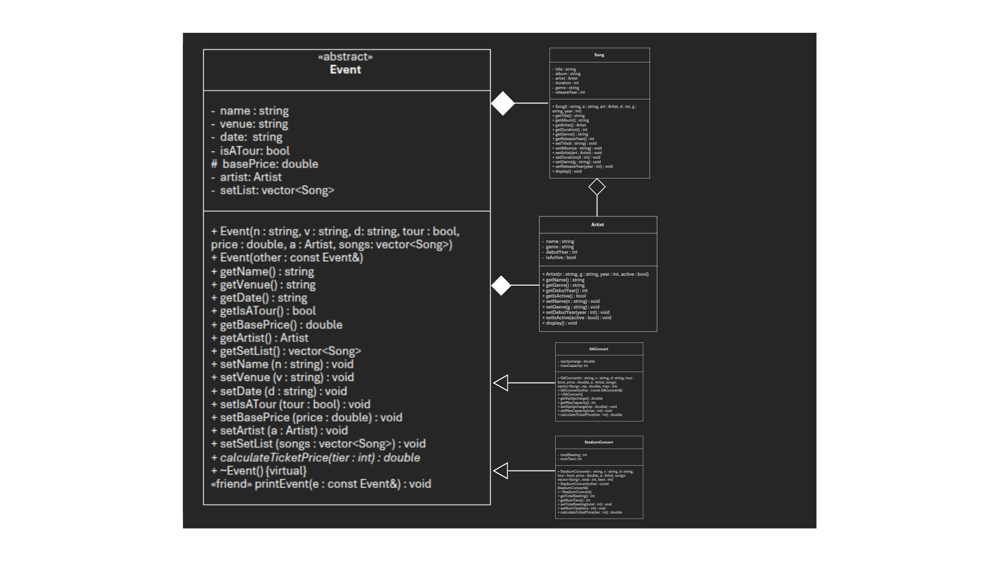
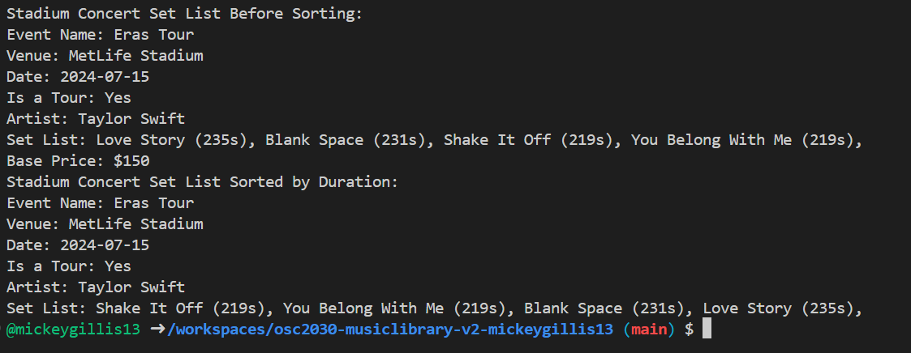

# Music Library
This music library version includes the ability to create/copy events and concerts for artists, as well as caluclate calculate theticker price of your seat using a base ticket price and tier number, representing the "level" of your seat. 

## Additional Classes
- Event
- StadiumConcert
- GAConcert

## Requirements
- Inheritance is shown a "is-a" relationship thorugh the event class, because GAConcert "is-a" Event, and so is StadiumConcert
- I have a constructor for both classes so each object isn't created without missing data. I have a virutal deconstructor for both classes so that the decosntructors for each class cleanup for StadiumConcert or GAConcert, and then event.
- I used a copy constructor in my main to create a copy of stadiumConcert1, and this can be used to help copy over events for both stadium concerts and general admission concerts
- My program uses polymorphishm through calculating ticket price. It does this thorugh a pointer that points to a refernce of stadiumConcert1, which then gets reassigned to a reference of gaConcert1. My code then correctly calculates the ticket price based off of the type of class that is referenced
-All of my private access specificers are the varaibles for each of my classess, and I have one protected access specifier for basePrice, so that my derived classes can use basePrice in them.
- printEvent is a friend function that can use private access specifiers to directly access variables outside that direct class, without the variables needing to have publci access.
- Event is my abstract class becuase caluclateTicketPrice is a pure virtual function. There is no single way to price an "evemt", so it forces every derived way implement pricing.

## Week 13 - Sorting Algorithm

### Data Structure

setList, which is a vector<Song> inside of Event. Each concert stores its songs in this vector, and displays them through printEvent.

### Sorted Output

The items are sorted by song duration, in seconds, with the sort order being from lowest amount of time to highest amount of time.

### Time and Space Complexity

The best case is O(n), which would be if the song durations are already sorted. This is the best case scenario because if no swaps happen in the first pass, the sort stops after one pass with just n comparisons. The average case is O(n²), where most of the time, the loops do n*n comparisons. Worst case scenario is O(n²), which is when the songs start in reverse order of duration. Worst case scenario does n²/2 swaps, compared to average, which does n²/4 swaps. Bubble sort is O(1) space complexity, sorting in place, rearranging songs inside the already existing vector with only a few extra variables.

Sources:
- [Time and Space Complexity Analysis of Bubble Sort – GeeksforGeeks](https://www.geeksforgeeks.org/time-and-space-complexity-analysis-of-bubble-sort/)

### Reflection Questions
1. **What sorting algorithm did you choose, and why?**
I chose bubble sort, mainly because I'm most familiar with it. It is also pretty simple to work with, working well for smaller data sets.
2. **What are the best, worst, and average-case time complexities? How did you expect it to perform with your dataset?**
For bubble sort, the best is O(n), average O(n²), and worst O(n²). I expected this to perform pretty well because I knew I didn't have a lot of data, which bubble sort excels at doing. Even though setList1 starts in reverse order, at this size of data sets, it didn't really matter.
3. **How does the space complexity affect memory usage?**
With lower space complexity, the same amount of memory is used no matter what, whether 4 songs or 4,000 songs. This is good for minimal usage of memory, and sort only uses the vector that already exists.
4. **What are its strengths and weaknesses? When is it useful or not recommended?**
Bubble sort exhibits quadratic growth with larger data sets, which is its biggest weakness, but it is pretty simple and requires only O(1) memory. It is most useful for smaller data sets, and shouldn't be used in this scenario for large music libraries.
5. **How might sorted data affect the user experience?**
Sorted data can help the user organize things in their head easier. This is much better, instead of having to bounce around from each piece of information. This helps the searching aspect of the user experience, like looking for all the short songs at the start, instead of having to look through the whole list.